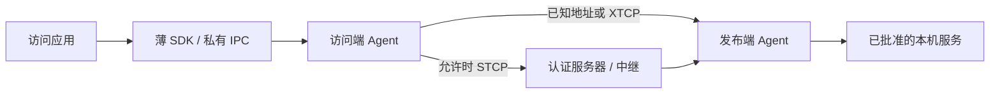

# LinkGate

**为自己的应用提供直连优先的设备间连接。** Windows 发布本机服务，Windows 或 Android 应用通过薄 SDK 访问；可用路径包括已知地址直连、FRP XTCP 打洞与授权的 STCP 中继。直连成功时，业务流量不经过中继服务器。

当前为可安装**试用版**，适合自己的设备和应用接入实验。Windows `0.3.0-preview.2`，Android `0.3.0-preview.3`（应用名 LinkGate、versionCode 4）；Linux amd64 提供认证控制与后端服务。Windows 安装包自带 .NET 和匹配运行时。

[下载安装包](https://github.com/stardust2716/LinkGate/releases) · [部署安装](docs/DEPLOYMENT.md) · [架构](docs/ARCHITECTURE.md) · [构建](docs/BUILD.md) · [部署 skill](.agents/skills/linkgate-deploy/SKILL.md)

## 能做什么

- **应用接入**：Windows .NET SDK、Android Binder/流 SDK，支持 TCP 流上的 HTTP、HTTPS、WebSocket；业务保留自己的认证、TLS 与请求语义。
- **路径策略**：direct-first、fast-connect、direct-only；中继须经明确授权，已有 TCP 连接不会自动迁移，不自动重放业务。
- **设备与服务授权**：设备 mTLS、本地声明批准、精确设备/应用/服务 grant、服务器签名短期租约，以及发布端校验。
- **运行时管理**：相同授权范围复用 FRP 载体，业务流独立取消，撤权和停止回收自有资源。
- **实际连接记录**：区分选择路径和业务路径，记录字节、建立时间及正常/异常结束。STUN 成功、进程启动都不等于业务直连。
- **手机管理**：概览、设备、应用、设置四个入口；覆盖安装保留设备身份与配对。

## 如何开始

1. 从 Releases 下载 Windows Setup、Android APK 和 Linux 服务器包，核对 `SHA256SUMS.txt`。当前 Windows 安装器没有生产代码签名，Android 使用开发签名。
2. 按[部署指南](docs/DEPLOYMENT.md)部署认证服务器：使用独立低权限账户、身份、权限库和见证目录，开放所配置的两个 TCP 端口。
3. 用 Owner 工具创建所有者根、管理员和电脑身份；手机在“设置 → 设备身份”生成 CSR。只交换 CSR、公开证书和根证书，私钥留在产生它的设备。
4. 确认服务器/设备指纹，完成服务器设备权限和设备互信。启动 Windows 网关及手机前台网关。
5. 让业务应用通过 SDK 注册声明、申请精确访问；用户与发布端分别批准后打开连接。

安装网关并完成设备配对之后，**业务应用仍需要接入 SDK 并获得授权**。透明固定端口兼容入口尚未交付。可先使用随 Windows 包提供的独立 SDK 示例，再接入自己的应用。

### SDK 与示例

- [.NET 薄 SDK](gateway/windows/LinkGate.Client/README.md)
- [Android 流 SDK](gateway/android/client-streams/README.md)
- [随包独立示例及管理命令](gateway/release/README-template.md)
- [接口 schema](gateway/spec/README.md)、[工程规格](gateway/docs/SPEC.md)

## 数据路径

协调和必要中继由 ECS 或自己的 Linux 服务器承担，业务继续在电脑执行。两端 Agent 仍在数据路径中验证设备与服务授权；应用拿不到设备私钥、FRP 配置或任意拨号能力。

## 验证范围与限制

已有 Windows 安装/卸载保留身份、独立应用传输、实际 ECS 加密中继、撤权与子进程回收证据；Android 有独立 UID 模拟器 SDK 证据，当前手机升级、配对和手动启动已确认。[证据索引](gateway/docs/PROGRESS.md)保留各次成功与失败边界。

新版手机跨 NAT 业务、四组物理网络、10万短连接及24/72小时长稳仍待验收。旧0.2.3测试是历史记录，不能推导新版或所有网络的直连成功率。NAT、防火墙、运营商和 VPN 都会影响打洞；手机 Clash 可通过应用排除方式与 LinkGate 共存，须按真实网络验证。

后续任务包括服务 prepare/事件、更多适配器、自动网络恢复与 TUN 出站、证书轮换、生产签名和自动更新，见[后续 spec](gateway/docs/mature-release.sdd)。

## 仓库结构

| 目录 | 内容 |
| --- | --- |
| `docs/` | 面向新用户的部署、架构及构建入口 |
| `gateway/windows/` | Windows Agent、Owner、Broker、运行时与薄 SDK |
| `gateway/android/` | Android 应用、Binder 与 SDK |
| `gateway/control-plane/` | Go 认证与权限控制面 |
| `gateway/backend-frp/` | 固定 FRP 源码补丁、覆盖文件与验证工具 |
| `gateway/agent-core/`、`transport-core/` | Java 权限/连接核心与设备传输 |
| `gateway/contracts/`、`spec/` | 跨平台合同与共享样本 |
| `gateway/docs/` | 详细规格、ADR、历史证据与待办 |
| `.agents/skills/linkgate-deploy/` | 可供其他 Agent 使用的部署 skill |

保留 `gateway/` 路径是为了延续现有构建和验证脚本；克隆本仓库即可取得源码，不需要另行克隆 ReDesk。旧版构建入口和服务器材料保留为历史实现，当前安装从 `gateway/release/` 与本 README 开始。

## 开发与许可

采用 [SpecDD](gateway/docs/SPEC-DD.md) 管理实现：先读取 AGENTS 和相邻 `.sdd`，只执行与改动相关的检查。构建不会自动部署服务器或操作手机。

项目许可证见 [AGPL-3.0](LICENSE)，上游与第三方许可见 [THIRD_PARTY.md](THIRD_PARTY.md)。请勿提交私人配置、配对凭据、签名私钥、令牌或生成运行时。
